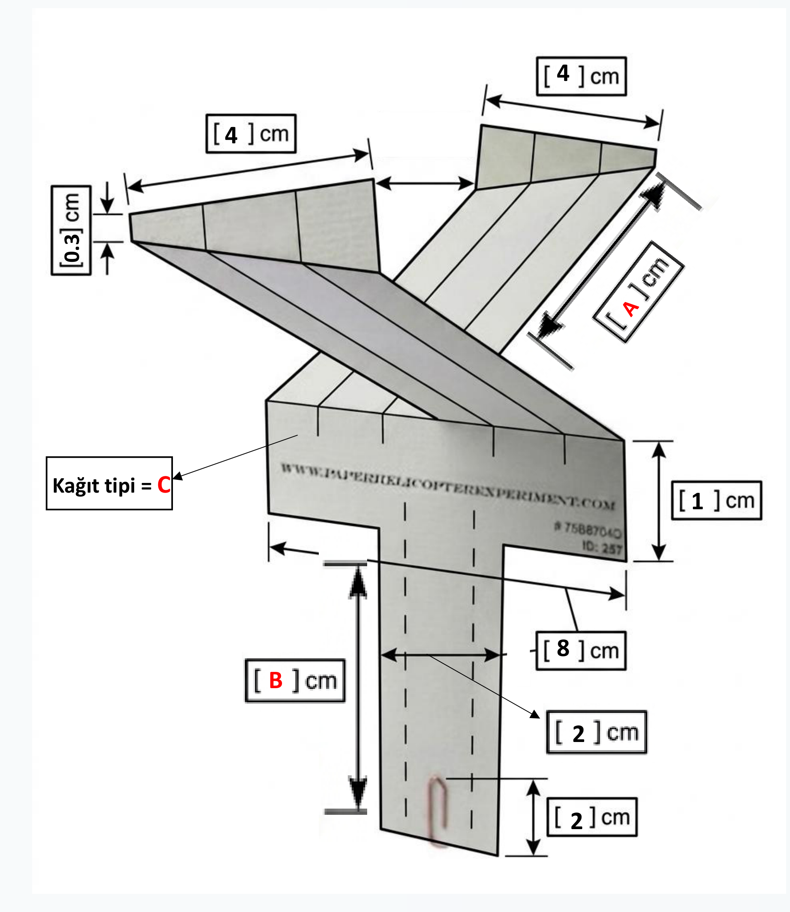
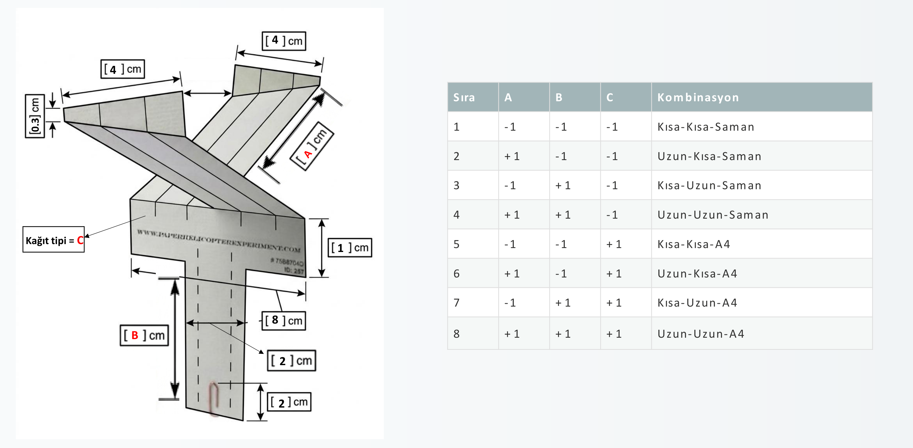
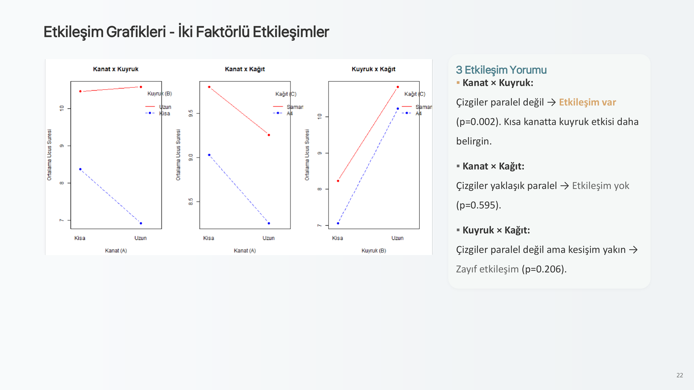

# 🚁 Kağıt Helikopterlerde Uçuş Süresini Etkileyen Faktörlerin İncelenmesi

[](https://www.r-project.org/)
[](LICENSE)
[](#deney-tasar%C4%B1m%C4%B1)
[](https://github.com/kaanboztas/paper-helicopter-doe-analysis)

Bu proje, kağıt helikopterlerin serbest düşüşte havada kalma (uçuş) süresini maksimize etmek amacıyla gerçekleştirilmiş bir **3 Etkenli Tam Faktöriyel İstatistiksel Deney Tasarımı ($2^3$)** çalışmasıdır.

Her faktör kombinasyonu için 3 bağımsız tekrar yapılarak toplam **24 gözlem** elde edilmiş; varyans analizi (ANOVA), artık analizleri, etkileşim testleri ve tahmini marjinal ortalamalar (`emmeans`) kullanılarak aerodinamik olarak en kararlı ve optimal uçuş süresini sağlayan helikopter tasarımı belirlenmiştir.

---

## 📌 İçindekiler

- [Örnek Helikopter Tasarımı ve Ölçü Şeması](#-örnek-helikopter-tasarımı-ve-ölçü-şeması)
- [Deney Tasarımı ve Faktörler](#-deney-tasarımı-ve-faktörler)
- [Tasarım Kombinasyonları Matrisi](#-tasarım-kombinasyonları-matrisi)
- [Özel Helikopter Taslakları](#-özel-helikopter-taslakları-ve-prototipler)
- [İstatistiksel Bulgular ve ANOVA Modeli](#-istatistiksel-bulgular-ve-anova-modeli)
- [Etkileşim Analizi](#-etkileşim-analizi)
- [Optimal Tasarım Önerisi](#-optimal-tasarım-önerisi)
- [Proje Klasör Yapısı](#-proje-klasör-yapısı)
- [Kurulum ve Çalıştırma](#-kurulum-ve-çalıştırma)
- [Akademik Bilgi](#-akademik-bilgi)

---

## 📐 Örnek Helikopter Tasarımı ve Ölçü Şeması

Aşağıdaki görselde, deneyde kullanılan helikopterlerin katlama ve kesim şablonu, sabit ve değişken boyutları ile parametre yerleşimleri gösterilmektedir:

<p align="center">
  
</p>

### Sabit ve Değişken Boyutların Açıklaması:

- **Kanat Uzunluğu ($A$):** Değişken faktör (Kısa: 130 mm / Uzun: 150 mm)
- **Kuyruk Uzunluğu ($B$):** Değişken faktör (Kısa: 100 mm / Uzun: 130 mm)
- **Kağıt Türü ($C$):** Değişken faktör (Saman Kağıdı / Standart 80g A4)
- **Kanat Genişliği:** `40 mm` (Sabit)
- **Gövde Genişliği:** `80 mm` (Sabit)
- **Gövde Üst Kısmı:** `10 mm` (Sabit)
- **Kuyruk Genişliği:** `20 mm` (Sabit)
- **Alt Kıvrım / Ağırlık Bölgesi:** `20 mm` (Sabit - 1 adet metal ataç ile dengelenmiştir)
- **Kanat Ucu Açısı:** `105°` (Sabit eğim)

---

## 🔬 Deney Tasarımı ve Faktörler

### 1. Sabit Tutulan Parametreler

| Parametre | Değer / Koşul | Açıklama |
|:---|:---|:---|
| **Düşme Yüksekliği** | ~6.0 Metre | Sabit yükseklikten dikey serbest bırakma |
| **Ortam Koşulları** | Kapalı Alan | Hava akımı ve rüzgar etkisi sıfırlanmıştır |
| **Ölçüm Yöntemi** | Kronometre | Bırakma anından yere temas anına kadar elle ölçüm |
| **Ağırlık Merkezi** | 1 Adet Standart Ataç | Gövde alt kısmına takılı |
| **Kanat Genişliği** | 40 mm | Tüm modellerde sabit tutulmuştur |
| **Gövde Genişliği** | 80 mm | Tüm modellerde sabit tutulmuştur |

### 2. Değişken Faktörler ve Düzeyleri ($2^3$)

| Faktör Kodu | Faktör Adı | Düşük Seviye ($-1$) | Yüksek Seviye ($+1$) |
|:---:|:---|:---:|:---:|
| **$A$** | **Kanat Uzunluğu** | Kısa (130 mm) | Uzun (150 mm) |
| **$B$** | **Kuyruk Uzunluğu** | Kısa (100 mm) | Uzun (130 mm) |
| **$C$** | **Kağıt Türü** | Saman Kağıdı (İnce / Hafif) | A4 Kağıdı (Kalın / Ağır) |

---

## 📊 Tasarım Kombinasyonları Matrisi

Tam faktöriyel matris ($2^3 = 8$ farklı tasarım, her biri için 3 tekrar):

<p align="center">
  
</p>

| Deneme No | $A$ (Kanat) | $B$ (Kuyruk) | $C$ (Kağıt) | Kombinasyon Tanımı | Tekrar Sayısı | Ortalama Uçuş Süresi (sn) |
|:---:|:---:|:---:|:---:|:---|:---:|:---:|
| **1** | $-1$ (Kısa) | $-1$ (Kısa) | $-1$ (Saman) | Kısa - Kısa - Saman | 3 | 9.09 sn |
| **2** | $+1$ (Uzun) | $-1$ (Kısa) | $-1$ (Saman) | Uzun - Kısa - Saman | 3 | 7.37 sn |
| **3** | $-1$ (Kısa) | $+1$ (Uzun) | $-1$ (Saman) | Kısa - Uzun - Saman | 3 | 10.51 sn |
| **4** | $+1$ (Uzun) | $+1$ (Uzun) | $-1$ (Saman) | **Uzun - Uzun - Saman** | 3 | **11.14 sn (Maksimum)** |
| **5** | $-1$ (Kısa) | $-1$ (Kısa) | $+1$ (A4) | Kısa - Kısa - A4 | 3 | 7.65 sn |
| **6** | $+1$ (Uzun) | $-1$ (Kısa) | $+1$ (A4) | Uzun - Kısa - A4 | 3 | 6.47 sn (Minimum) |
| **7** | $-1$ (Kısa) | $+1$ (Uzun) | $+1$ (A4) | Kısa - Uzun - A4 | 3 | 10.41 sn |
| **8** | $+1$ (Uzun) | $+1$ (Uzun) | $+1$ (A4) | Uzun - Uzun - A4 | 3 | 10.03 sn |

---

## 🎨 Özel Helikopter Taslakları ve Prototipler

Bu çalışmada tasarlanan ve üretilen helikopterlerin fiziksel taslakları ve prototip çizimleri [`taslaklar/`](taslaklar/) dizininde bulunmaktadır.

> 📁 **Kendi Taslaklarınızı Ekleyin:**
> Eğer yeni kanat profilleri, kıvrım şablonları veya prototip fotoğrafları eklemek isterseniz, lütfen dosyalarınızı [`taslaklar/`](taslaklar/) klasörüne ekleyiniz. Detaylı yönergeler için [taslaklar/README.md](taslaklar/README.md) dosyasını inceleyebilirsiniz.

---

## 📈 İstatistiksel Bulgular ve ANOVA Modeli

Tam faktöriyel ANOVA modeli formülasyonu:

$$Y_{ijkl} = \mu + A_i + B_j + C_k + (AB)_{ij} + (AC)_{ik} + (BC)_{jk} + (ABC)_{ijk} + \epsilon_{ijkl}$$

### ANOVA Özeti

- **Model Açıklayıcılığı ($R^2$):** **%93.35** ($R^2_{adj} = 0.9044$). Uçuş süresindeki varyasyonun büyük çoğunluğu modeldeki faktörler tarafından açıklanmaktadır.
- **Kuyruk Uzunluğu ($B$):** $F = 175.76$, $p < 0.001$ $\rightarrow$ Uçuş süresini en güçlü artıran faktördür ($\eta^2 = 0.77$).
- **Kanat Uzunluğu ($A$):** $F = 9.47$, $p = 0.007$ $\rightarrow$ İstatistiki olarak anlamlı ana etki.
- **Kağıt Türü ($C$):** $F = 21.65$, $p < 0.001$ $\rightarrow$ Saman kağıdı (hafif malzeme) uçuş süresini anlamlı derecede uzatmaktadır.
- **Kanat $\times$ Kuyruk Etkileşimi ($A \times B$):** $F = 13.91$, $p = 0.002$ $\rightarrow$ Çok anlamlı etkileşim!

### Varsayım Testleri (Artık Analizi)

- **Normallik:** Shapiro-Wilk testi $p = 0.887 > 0.05$ (Normallik varsayımı mükemmel şekilde sağlanmıştır).
- **Varyans Homojenliği:** Levene testi $p = 0.354 > 0.05$ ve Bartlett testi $p = 0.395 > 0.05$ (Eşvaryanslık varsayımı sağlanmıştır).

---

## 🔄 Etkileşim Analizi

<p align="center">
  
</p>

- **Kanat $\times$ Kuyruk:** Çizgiler paralel değildir ($p = 0.002$). Kısa kanatta kuyruk uzunluğunun etkisi çok daha belirgindir; uzun kuyruk ile birlikte uzun kanat aerodinamik kaldırma kuvvetini tepe noktasına taşımaktadır.
- **Kanat $\times$ Kağıt:** Çizgiler birbirine paraleldir ($p = 0.595$), aralarında anlamlı bir etkileşim bulunmamaktadır.
- **Kuyruk $\times$ Kağıt:** Zayıf etkileşim ($p = 0.206$).

---

## 🏆 Optimal Tasarım Önerisi

Tüm faktör kombinasyonlarının model üzerinden tahmin edilen uçuş süreleri ve %95 güven aralıkları:

| Sıra | Tasarım Kombinasyonu | Tahmini Uçuş Süresi (fit) | %95 Güven Aralığı (lwr - upr) | Değerlendirme |
|:---:|:---|:---:|:---:|:---|
| 🥇 **1** | **Uzun Kanat + Uzun Kuyruk + Saman** | **11.143 sn** | **[10.490 - 11.796]** | **En Optimal Tasarım** |
| 🥈 2 | Kısa Kanat + Uzun Kuyruk + Saman | 10.510 sn | [9.857 - 11.163] | Yüksek Performans |
| 🥉 3 | Kısa Kanat + Uzun Kuyruk + A4 | 10.413 sn | [9.760 - 11.066] | Yüksek Performans |
| 4 | Uzun Kanat + Uzun Kuyruk + A4 | 10.030 sn | [9.377 - 10.683] | Orta-Yüksek |
| 5 | Kısa Kanat + Kısa Kuyruk + Saman | 9.093 sn | [8.440 - 9.746] | Orta Seviye |
| 6 | Kısa Kanat + Kısa Kuyruk + A4 | 7.647 sn | [6.994 - 8.299] | Düşük Seviye |
| 7 | Uzun Kanat + Kısa Kuyruk + Saman | 7.370 sn | [6.717 - 8.023] | Kararsız Düşüş |
| 8 | Uzun Kanat + Kısa Kuyruk + A4 | 6.473 sn | [5.820 - 7.126] | En Düşük Süre |

> 📌 **Sonuç:** Havada en uzun süre kalmayı sağlayan optimal helikopter yapısı:
> **150 mm Uzun Kanat + 130 mm Uzun Kuyruk + Hafif Saman Kağıdı** kombinasyonudur.

---

## 📁 Proje Klasör Yapısı

```text
├── data/
│   └── helicopter_flight_data.csv          # 24 gözlemli ham deney veri seti
├── docs/
│   ├── images/                             # PDF'ten çıkarılan şemalar ve grafikler
│   │   ├── helicopter_design_spec.png      # Örnek helikopter tasarım şeması
│   │   ├── helicopter_design_and_combinations.png # Şablon ve faktör kombinasyonları
│   │   ├── slide_22_interaction_plots.png # ANOVA etkileşim grafikleri
│   │   └── slide_14_residual_analysis.png  # Artık analizi grafikleri
│   └── Kağıt Helikopterlerde Uçuş Süresini Etkileyen Faktörlerin İncelenmesi.pdf # Orijinal sunum/rapor
├── taslaklar/
│   └── README.md                           # Özel helikopter çizim ve prototip rehberi
├── helikopter_deneyi_analiz.R              # Temiz ve açıklamalı R analiz kodu (UTF-8)
├── .gitignore                              # Git hariç tutma kuralları
├── LICENSE                                 # MIT Lisansı
└── README.md                               # Proje dokümantasyonu (bu dosya)
```

---

## 🚀 Kurulum ve Çalıştırma

### Gereksinimler

- [R (>= 4.0.0)](https://cran.r-project.org/)
- Önerilen arayüz: [RStudio Desktop](https://posit.co/download/rstudio-desktop/)

### R Paketleri

Analiz komut dosyasını çalıştırmadan önce gerekli paketleri yükleyin:

```r
install.packages(c("car", "emmeans", "agricolae", "effectsize"))
```

### Analizin Çalıştırılması

Terminal üzerinden veya RStudio içinde:

```bash
Rscript helikopter_deneyi_analiz.R
```

---

## 🎓 Akademik Bilgi

- **Ders:** İST 3032 - İstatistiksel Deney Tasarımı (Design of Experiments)
- **Araştırmacı / Öğrenci:** Kaan Boztaş
- **Öğrenci No:** 2022285066
- **Tarih:** 2026

---

## 📄 Lisans

Bu proje [MIT Lisansı](LICENSE) altında lisanslanmıştır. Bilimsel ve eğitim amaçlı serbestçe kullanılabilir.
